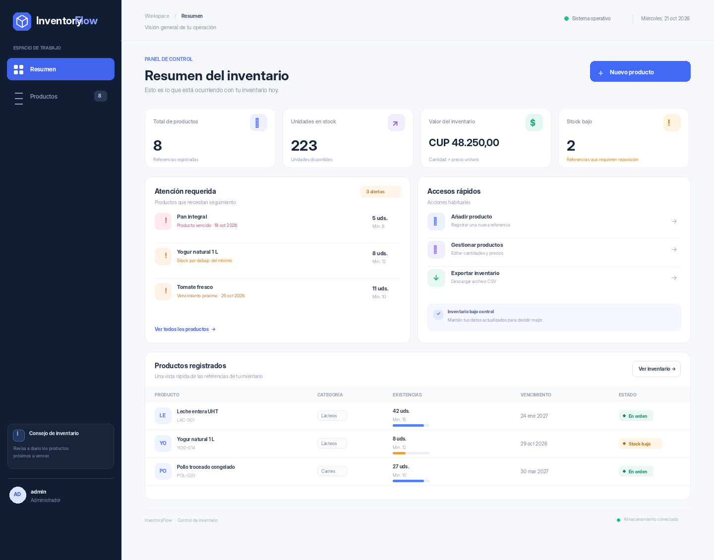

# InventoryFlow

Aplicación web para administrar el inventario de un distribuidor de productos perecederos. El proyecto incluye una interfaz adaptable a móviles, una API REST con Node.js y Express, autenticación de administrador, alertas de stock y vencimiento, operaciones CRUD y exportación CSV.



*Vista preliminar con datos de ejemplo; no representa una instancia desplegada.*

## Funcionalidades

- **Resumen:** referencias registradas, unidades en existencia, valor estimado del inventario y productos con stock bajo.
- **Catálogo:** registrar, consultar, editar y eliminar productos.
- **Búsqueda y filtros:** por SKU, nombre, categoría, proveedor, stock bajo y vencimiento.
- **Productos perecederos:** identifica existencias vencidas y productos que vencen en los próximos siete días.
- **Exportación CSV:** descarga el inventario para abrirlo en Excel o LibreOffice.
- **Acceso protegido:** sesión de administrador con cookie `HttpOnly`, `SameSite=Lax`, límite de intentos de inicio de sesión y cabeceras de seguridad.
- **Persistencia flexible:** PostgreSQL cuando se configura `DATABASE_URL`; archivo JSON para ejecución local sin instalar una base de datos.
- **API de salud:** `GET /api/health` permite comprobar el estado del servicio.

## Tecnologías

- Node.js 20.19 o posterior.
- Express 5.
- PostgreSQL con `pg` (opcional para el modo local; recomendado en el despliegue).
- HTML, CSS y JavaScript del navegador sin proceso de compilación frontend.
- `express-session`, `express-rate-limit` y Helmet.
- Pruebas automatizadas con el módulo `node:test` de Node.js.

## Ejecución local

Requiere Node.js y npm. No necesita Docker ni una base de datos para la primera ejecución.

```bash
# 1. Instalar dependencias
npm install

# 2. Crear el archivo de variables (PowerShell: Copy-Item .env.example .env)
cp .env.example .env

# 3. Iniciar en modo desarrollo
npm run dev
```

Abre `http://localhost:3000`.

**Acceso local inicial:** usuario `admin`, contraseña `Inventario123!`, solo si no definiste `ADMIN_PASSWORD` en `.env`. Cambia estas credenciales antes de publicar la aplicación. El archivo `.env` no debe subirse al repositorio.

Para ejecutar las pruebas:

```bash
npm test
```

## Despliegue en Render

El repositorio incluye `render.yaml` para configurar el servicio web. Consulta también la [guía oficial de Web Services de Render](https://render.com/docs/web-services) y su [tutorial de despliegue de Node.js/Express](https://render.com/docs/deploy-node-express-app). Render necesita que la aplicación escuche en `0.0.0.0` y en el puerto de la variable `PORT`; el servidor ya cumple ambos requisitos.

1. Crea un repositorio vacío en GitHub. Puede ser público o privado; si es privado, conecta Render con GitHub y luego añade al profesor como colaborador desde **Settings → Collaborators**.
2. Desde la carpeta descomprimida, inicializa y sube el código (cambia la URL de ejemplo por la de tu repositorio):
   ```bash
   git init
   git add .
   git commit -m "feat: implement InventoryFlow"
   git branch -M main
   git remote add origin https://github.com/USUARIO/REPOSITORIO.git
   git push -u origin main
   ```
3. En Render, selecciona **New → Blueprint** y conecta el repositorio, o crea un **Web Service** vinculado al repo.
4. Si usas Web Service manual, configura:
   - **Runtime:** Node.
   - **Build Command:** `npm install --omit=dev`.
   - **Start Command:** `npm start`.
   - **Health Check Path:** `/api/health`.
5. Añade las variables siguientes en **Environment**:
   - `NODE_ENV=production`
   - `ADMIN_USERNAME=admin` (o el usuario que elijas)
   - `ADMIN_PASSWORD`: una contraseña robusta, propia y diferente de la contraseña de desarrollo.
   - `SESSION_SECRET`: una cadena aleatoria de al menos 32 caracteres. El Blueprint propone generar una automáticamente.
   - `DATABASE_URL`: URL de conexión de PostgreSQL si vas a conservar los datos entre reinicios y despliegues.
   - `DATABASE_SSL=false` para una conexión interna de Render; `true` si el proveedor externo requiere SSL.
6. Pulsa **Deploy** y comprueba que el estado del servicio indique que está disponible. En el plan gratuito, el servicio puede entrar en reposo cuando no recibe tráfico. Abre la URL pública `https://<servicio>.onrender.com` y prueba el inicio de sesión, la creación de un producto y la exportación CSV.
### Importante sobre la base de datos

Sin `DATABASE_URL`, la aplicación utiliza un archivo JSON local y carga datos de ejemplo. Es útil para desarrollo y demostración, pero el sistema de archivos de un servicio web de Render no debe tratarse como almacenamiento permanente. Para conservar productos reales, conecta una base de datos PostgreSQL y establece `DATABASE_URL` con su cadena de conexión. Configura base de datos y servicio preferiblemente en la misma región y no publiques la cadena de conexión.

## API principal

Las rutas de inventario exigen una sesión válida. El formato de respuesta es JSON salvo la exportación CSV.

| Método | Ruta | Descripción |
|---|---|---|
| `GET` | `/api/health` | Estado del servidor y tipo de almacenamiento |
| `POST` | `/api/auth/login` | Iniciar sesión |
| `GET` | `/api/auth/me` | Consultar la sesión actual |
| `POST` | `/api/auth/logout` | Cerrar sesión |
| `GET` | `/api/dashboard` | Métricas y alertas |
| `GET` | `/api/products` | Consultar productos |
| `POST` | `/api/products` | Registrar producto |
| `PUT` | `/api/products/:id` | Actualizar producto |
| `DELETE` | `/api/products/:id` | Eliminar producto |
| `GET` | `/api/products/export.csv` | Exportar el catálogo a CSV |

### Ejemplo de creación de producto

Después de iniciar sesión, envía una solicitud `POST /api/products` con un cuerpo como este:

```json
{
  "sku": "JUG-025",
  "name": "Jugo de guayaba 1 L",
  "category": "Bebidas",
  "supplier": "Distribuidora Central",
  "quantity": 24,
  "min_stock": 8,
  "price": 180,
  "expiration_date": "2027-03-15"
}
```

## Estructura del proyecto

```text
inventoryflow/
├── data/                  # Archivo JSON local (generado al iniciar)
├── docs/
│   └── captura-dashboard.png
├── lib/
│   └── domain.js          # Validaciones y reglas de dominio
├── public/
│   ├── app.js              # Comportamiento de la interfaz
│   ├── index.html          # Interfaz de usuario
│   └── styles.css          # Diseño adaptable
├── test/
│   └── validation.test.js  # Pruebas automatizadas
├── .env.example
├── .gitignore
├── package.json
├── render.yaml
└── server.js               # API REST, autenticación y almacenamiento
```

## Entrega académica

- **Aplicación desplegada:** pegar aquí la URL pública de Render cuando el despliegue haya finalizado.
- **Repositorio:** pegar aquí la URL del repositorio GitHub y añadir al profesor como colaborador si el repositorio es privado.
- **README:** este documento incluye la guía de ejecución, funcionalidades, tecnologías, API y captura del panel.

## Limitaciones conocidas

- Si no se configura PostgreSQL en el despliegue, los cambios guardados en JSON pueden perderse cuando Render sustituya la instancia.
- El servicio implementa una cuenta administradora configurable por variables de entorno; para un despliegue con varios usuarios se recomienda ampliar el modelo de identidad y permisos.
- Los datos iniciales son ficticios y sirven para probar el flujo de la aplicación.

## Licencia

MIT.
